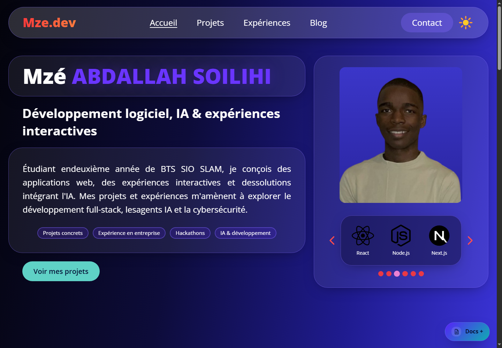
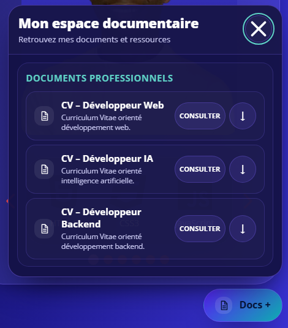

# Portfolio Mze.dev

Portfolio personnel de **Mzé ABDALLAH SOILIHI**, étudiant en BTS SIO SLAM et développeur intéressé par le développement web, l’intelligence artificielle et la cybersécurité.

🌐 **Voir le portfolio en ligne :** [mze-assaf.netlify.app](https://mze-assaf.netlify.app/)

💻 **Code source :** [GitHub — portfolio-3.1](https://github.com/ABDALLAHSOILIHIMzeAssaf/portfolio-3.1)

Ce guide est écrit pour deux publics :

- **Visiteur ou personne qui ne code pas :** découvrir le site, ses fonctionnalités et les CV.
- **Développeur ou contributeur :** installer le projet, le lancer, le modifier et le publier.

## Sommaire

- [Aperçu du site](#aperçu-du-site)
- [Pour les visiteurs](#pour-les-visiteurs)
- [Technologies](#technologies)
- [Organisation du projet](#organisation-du-projet)
- [Lancer le site sur son ordinateur](#lancer-le-site-sur-son-ordinateur)
- [Modifier le contenu sans connaître le code](#modifier-le-contenu-sans-connaître-le-code)
- [Ajouter ou remplacer un CV](#ajouter-ou-remplacer-un-cv)
- [Pour les développeurs](#pour-les-développeurs)
- [Publication avec Netlify](#publication-avec-netlify)
- [Dépannage](#dépannage)

## Aperçu du site

Le site est un portfolio monopage : les différentes rubriques se trouvent sur une même page. La navigation permet d’aller directement à une rubrique.

### Accueil



### Espace documentaire Docs+

Le bouton flottant **Docs +**, en bas à droite, ouvre un panneau contenant les trois CV disponibles. Un clic sur **Consulter** ouvre le PDF dans un nouvel onglet ; la flèche permet de le télécharger.



## Pour les visiteurs

### Rubriques

| Rubrique | Contenu |
|---|---|
| **Accueil** | Présentation, photo et carrousel des technologies. |
| **Projets** | Projets web et interactifs, technologies utilisées, démos et dépôts GitHub lorsqu’ils sont disponibles. |
| **Expériences** | Expériences, stages, concours et certifications. Sélectionnez une expérience pour afficher les détails. |
| **Blog & veille** | Articles technologiques récents récupérés depuis Dev.to, avec filtres et recherche. |
| **Contact** | Coordonnées et formulaire de contact. |
| **Docs +** | Accès rapide aux CV et aux autres documents professionnels publiés. |

### Utilisation

- Utilisez les liens de navigation pour atteindre une rubrique.
- Le bouton avec le soleil ou la lune bascule entre les thèmes clair et sombre. Le choix est mémorisé dans le navigateur.
- Dans le carrousel d’accueil, utilisez les flèches ou les points pour parcourir les technologies.
- Dans **Expériences**, sélectionnez une entrée dans la liste pour lire les détails.
- Dans **Blog & veille**, choisissez un thème ou saisissez un terme dans la recherche.
- Cliquez sur **Docs +** pour ouvrir les documents. Le panneau se ferme avec son bouton de fermeture, la touche `Échap` ou un clic à l’extérieur.
- Le site s’adapte aux écrans mobiles et peut être utilisé au clavier.

## Technologies

Le projet n’utilise pas de framework JavaScript comme React ou Vue. C’est un site statique construit avec :

- **HTML5 sémantique** pour la structure et le contenu.
- **CSS** compilé avec **Tailwind CSS v4** pour la mise en page et les styles.
- **JavaScript natif ES6+** pour les interactions, sans bibliothèque JavaScript ajoutée.
- **Node.js et npm** pour les outils de développement et les scripts de génération.
- **Netlify** pour l’hébergement et le déploiement.

Le thème, les composants visuels et les animations sont définis dans `src/input.css`. Les préférences de couleurs sont aussi disponibles sous forme de variables CSS pour les thèmes clair et sombre. Le site respecte le réglage système de réduction des animations.

### Services externes

- **Dev.to** fournit les articles affichés dans la veille technologique. Si son API ne répond pas, le site affiche des liens de secours vers les thèmes concernés.
- **FormSubmit** relaie les messages du formulaire vers l’adresse configurée dans `js/main.js`. Le premier envoi peut nécessiter la confirmation de l’adresse par e-mail.
- **Google Fonts** fournit la police Open Sans. Une police système est prévue en remplacement si le service est indisponible.

## Organisation du projet

```text
portfolio-3.1/
├── index.html              Page unique : rubriques, navigation et panneau Docs+
├── src/
│   └── input.css            Source des styles Tailwind et des composants
├── css/
│   └── styles.css           Feuille CSS compilée et utilisée par le site
├── js/
│   ├── main.js              Interactions, expériences, blog, formulaire et Docs+
│   ├── theme.js             Application du thème avant l’affichage de la page
│   └── docs-config.js       Configuration des documents affichés dans Docs+
├── public/
│   └── docs/
│       ├── *.pdf            CV et autres documents publiés
│       └── manifest.json    Inventaire PDF généré par le script de build
├── scripts/
│   └── build-docs.mjs       Génération de l’inventaire des PDF
├── img/                     Portrait, logo, projets et icônes de technologies
├── docs/
│   └── screenshots/         Captures d’écran incluses dans ce README
├── netlify.toml             Configuration de build, sécurité et cache Netlify
├── _redirects               Redirections Netlify
├── robots.txt               Consignes des robots d’indexation
├── sitemap.xml              Plan du site pour les moteurs de recherche
└── package.json             Dépendances et commandes npm
```

### Comment les fichiers fonctionnent ensemble

```text
index.html
  ├── css/styles.css  ← compilé depuis src/input.css
  ├── js/theme.js
  ├── js/docs-config.js ──→ liste des documents Docs+
  └── js/main.js ─────────→ interactions du site et affichage des documents

public/docs/*.pdf ────────→ fichiers réellement ouverts ou téléchargés
scripts/build-docs.mjs ───→ public/docs/manifest.json
```

> **À retenir pour Docs+ :** `js/docs-config.js` détermine ce qui apparaît dans le panneau. Le manifeste est un inventaire généré des PDF ; il ne remplace pas la configuration du panneau. Pour publier un nouveau CV, il faut téléverser le PDF et l’ajouter à `docs-config.js`.

## Lancer le site sur son ordinateur

### Prérequis

- [Node.js](https://nodejs.org/) 20 ou une version récente compatible avec Tailwind CSS v4.
- npm, inclus avec Node.js.
- Git uniquement si vous souhaitez cloner le dépôt depuis un terminal.

### Installation et démarrage

Depuis un terminal, placez-vous dans le dossier du projet :

```bash
git clone https://github.com/ABDALLAHSOILIHIMzeAssaf/portfolio-3.1.git
cd portfolio-3.1
npm install
npm run build:css
npm run build
npm run dev -- --listen 4173
```

Ouvrez ensuite **http://localhost:4173** dans votre navigateur.
Si le dépôt est déjà présent sur votre ordinateur, passez directement aux commandes `npm`.

Sous Windows, le terminal intégré de VS Code ou PowerShell convient. La commande `cd` sert à rejoindre le dossier du projet ; par exemple :

```powershell
cd "C:\chemin\vers\portfolio-3.1"
```

`npm run dev` utilise `npx serve` pour servir le site statique. Lors de son premier lancement, npm peut avoir besoin d’une connexion Internet pour récupérer cet outil.

### Commandes disponibles

| Commande | Utilité |
|---|---|
| `npm install` | Installe les outils de développement déclarés dans `package.json`. |
| `npm run dev` | Démarre un serveur local de prévisualisation. |
| `npm run build:css` | Compile `src/input.css` vers `css/styles.css`. À lancer après une modification des styles ou des classes Tailwind dans le HTML/JavaScript. |
| `npm run build:docs` | Scanne `public/docs/` et recrée `public/docs/manifest.json`. |
| `npm run build` | Lance `build:docs`. **Cette commande ne compile pas le CSS.** |

Les fichiers `css/styles.css` et `public/docs/manifest.json` sont générés, mais sont aussi versionnés dans le dépôt. Après leur génération, vérifiez que les changements attendus figurent bien dans Git.

## Modifier le contenu sans connaître le code

La plupart du contenu est écrit directement dans `index.html`. Vous pouvez modifier les textes en ouvrant le fichier dans Visual Studio Code, puis en remplaçant seulement le texte concerné entre les balises. Évitez de supprimer les balises HTML autour du texte.

Pour les images, remplacez le fichier dans `img/` en conservant si possible le même nom. Si vous ajoutez une image sous un nouveau nom, il faut aussi modifier son chemin dans `index.html`. Conservez un texte `alt` descriptif pour les lecteurs d’écran.

### Modifier les CV avec l’interface GitHub

Il est possible de faire les changements sans ligne de commande :

1. Ouvrez le dépôt GitHub du portfolio et connectez-vous.
2. Pour ajouter un PDF, ouvrez le dossier `public/docs/`, choisissez **Add file** puis **Upload files**, et sélectionnez le fichier.
3. Pour l’afficher dans Docs+, ouvrez `js/docs-config.js` et choisissez l’icône de modification.
4. Copiez le bloc d’exemple de la section suivante et remplacez le titre, la description et le nom du fichier.
5. Enregistrez avec **Commit changes** sur la branche `master`.
6. Attendez la fin du déploiement Netlify et vérifiez le site en ligne.

L’interface GitHub évite d’installer un logiciel, mais l’étape 3 nécessite de copier un petit bloc de configuration. Ne modifiez pas le composant JavaScript du widget.

## Ajouter ou remplacer un CV

### Étape 1 — Ajouter le fichier PDF

Déposez le PDF dans :

```text
public/docs/
```

Utilisez un nom simple, par exemple `CV_Mze_Developpeur_Python.pdf`. Les noms pris en charge par le générateur utilisent des lettres, des chiffres, des espaces ou des tirets, et se terminent par `.pdf`.

### Étape 2 — Ajouter une entrée dans la configuration

Dans `js/docs-config.js`, ajoutez une entrée dans `items` de la catégorie voulue :

```js
{
  label: 'CV – Développeur Python',
  description: 'Curriculum Vitae orienté développement Python.',
  href: '/public/docs/CV_Mze_Developpeur_Python.pdf',
  download: true
}
```

Remplacez le nom du fichier dans `href` par le nom exact du PDF, en respectant les majuscules et minuscules. `label` et `description` sont les textes vus par le visiteur. `download: true` affiche également l’action de téléchargement. Les liens **Consulter** ouvrent le document dans un nouvel onglet.

Les catégories sont déjà préparées dans `js/docs-config.js` :

- `professional` — documents professionnels ;
- `credentials` — diplômes et certifications ;
- `projects` — projets ;
- `academic` — documents académiques.

Une catégorie sans document configuré n’apparaît pas dans le panneau. Ne créez pas d’entrée « à venir » avec un lien vide : le widget est prévu pour n’afficher que des documents accessibles.

### Étape 3 — Générer et vérifier l’inventaire

En local, lancez :

```bash
npm run build:docs
```

Le script `scripts/build-docs.mjs` détecte les PDF dans `public/docs/` et met à jour `public/docs/manifest.json`. Il ignore les autres formats. **Le manifeste est généré automatiquement : ne le modifiez pas à la main.**

Avant de publier, vérifiez que :

- le PDF existe dans `public/docs/` ;
- le nom dans `href` correspond exactement au fichier ;
- le document est listé dans le panneau local ;
- le bouton **Consulter** ouvre le bon PDF.

### Étape 4 — Publier les changements

Ajoutez au même commit le fichier PDF, `js/docs-config.js` et le manifeste régénéré. Une fois le changement poussé sur la branche de production, Netlify peut reconstruire et publier le site.

Pour remplacer un CV, ajoutez le nouveau fichier, modifiez son entrée dans `js/docs-config.js`, puis supprimez l’ancien PDF uniquement s’il n’est plus utilisé ailleurs.

## Pour les développeurs

### HTML et scripts

- `index.html` contient la page, sa navigation, les textes, le SEO et les éléments HTML du widget Docs+.
- `js/theme.js` applique le thème mémorisé avant que la page s’affiche.
- `js/main.js` regroupe le JavaScript sans dépendance : menu mobile, carrousel, expériences, flux Dev.to, formulaire, toast et Docs+.
- Les données du widget sont séparées dans `js/docs-config.js`, ce qui permet de modifier les documents sans réécrire son rendu.
- Le JavaScript du widget construit ses éléments DOM sans injecter de chaînes HTML de documents.

### Styles et thèmes

- Modifiez `src/input.css`, qui est la source des styles.
- Après un changement des styles ou l’ajout de nouvelles classes Tailwind dans le HTML/JavaScript, lancez `npm run build:css`.
- Le fichier généré `css/styles.css` est celui qui est chargé par le navigateur : n’oubliez pas de le commiter.
- Les couleurs s’appuient sur les variables de thème de `src/input.css`.

### Vérifications

Il n’y a pas de commande de tests automatisés déclarée dans `package.json`. Avant une contribution, les vérifications disponibles comprennent :

```bash
npm run build:css
npm run build
node --check js/main.js
node --check js/docs-config.js
```

Vérifiez aussi les principales interactions dans le navigateur : menu mobile, changement de thème, navigation, filtres de veille, formulaire et ouverture/fermeture de Docs+.

### SEO, redirections et sécurité

- Les métadonnées et données structurées sont dans `index.html`.
- `sitemap.xml` et `robots.txt` décrivent le site aux moteurs de recherche.
- `_redirects` gère les redirections Netlify.
- `netlify.toml` définit le dossier publié, la commande de build, les en-têtes HTTP et la politique CSP.
- Si le domaine change, mettez à jour l’URL canonique et les URL Open Graph dans `index.html`, ainsi que `sitemap.xml`, `robots.txt` et les redirections concernées.

N’ajoutez pas de clés privées, mots de passe ou jetons d’accès dans les fichiers du site : le contenu publié est public.

## Publication avec Netlify

La configuration actuelle du dépôt dans `netlify.toml` indique :

- **Dossier publié :** la racine du dépôt (`.`).
- **Commande de build :** `node scripts/build-docs.mjs`.
- **Branche utilisée ici :** `master`.

Le déploiement Netlify régénère l’inventaire des PDF puis publie les fichiers du dépôt, dont les PDF et `js/docs-config.js`. Le CSS compilé est fourni dans `css/styles.css`.

Après un commit :

1. Vérifiez que le commit est bien poussé sur `master`.
2. Dans Netlify, ouvrez le site correspondant et consultez **Deploys**.
3. Vérifiez que le dernier déploiement utilise le bon commit et que son état est **Published**.
4. Si nécessaire, déclenchez **Deploy site** / **Retry deploy** pour le dernier commit.
5. Testez le site en ligne et ouvrez réellement chaque PDF.
6. Si un ancien fichier persiste malgré un déploiement réussi, rechargez sans cache (`Ctrl+F5`) et vérifiez les URLs de fichiers servies par le site.

Un commit GitHub et un déploiement Netlify sont deux opérations distinctes : voir le commit dans GitHub ne garantit pas que le dernier déploiement de production l’a déjà publié.

## Dépannage

| Problème | Cause probable | Solution |
|---|---|---|
| Les anciens CV restent visibles en ligne | Le dernier déploiement Netlify n’a pas publié le commit contenant les nouveaux fichiers. | Vérifiez la branche de production, le commit du dernier déploiement et son état **Published**. |
| Docs+ s’ouvre mais n’affiche aucun document | `js/docs-config.js` est invalide, absent ou contient des marqueurs de conflit Git. | Vérifiez la syntaxe avec `node --check js/docs-config.js` et retirez tout marqueur `<<<<<<<`, `=======` ou `>>>>>>>`. |
| Un CV affiche une erreur 404 | Le nom ou le chemin configuré ne correspond pas au PDF publié. | Comparez exactement `href` avec le nom présent dans `public/docs/`, y compris la casse et l’extension. |
| Le manifeste ne contient pas un fichier | Le générateur n’inventorie que les PDF dont le nom est autorisé. | Vérifiez l’extension `.pdf`, le nom du fichier, puis relancez `npm run build:docs`. |
| Les styles changés n’apparaissent pas | Le CSS compilé n’a pas été régénéré ou le navigateur utilise une version précédente. | Lancez `npm run build:css`, commitez `css/styles.css`, vérifiez le déploiement et rechargez sans cache. |
| `npm run dev` ne démarre pas | Les dépendances ne sont pas installées, le port est déjà utilisé, ou `npx` ne peut pas récupérer `serve`. | Exécutez `npm install`, choisissez un autre port (`--listen 4174`) et vérifiez la connexion Internet au premier lancement. |
| Le formulaire ne transmet pas les messages | Le service FormSubmit n’a pas été activé ou est temporairement indisponible. | Vérifiez la boîte de réception de l’adresse configurée et confirmez le premier message d’activation envoyé par FormSubmit. |
| La veille n’affiche pas les articles récents | L’API Dev.to peut être indisponible ou limiter temporairement les requêtes. | Réessayez plus tard ; le site fournit des liens de secours vers les thèmes. |

## Contact

Les informations de contact à jour figurent dans la rubrique **Contact** du [portfolio en ligne](https://mze-assaf.netlify.app/).
